## Contents
 1. Research Questions
 2. Data Overview
 3. Analysis
    - Part 1: Spatial and Structural Analysis
    - Part 2: Temporal Analysis
    - Part 3: User Preference Analysis
 4. Key Findings and Conclusion
 5. Limitation
 6. Discussion
 
## Research Questions
 - *RQ 1: Spatial and Structural Analysis*
    - How are library transactions distributed across different **locations and branches**?
    - Which libraries play a central role in the network of **inter-branch interactions**?
 - *RQ 2: Temporal Usage Pattern Analysis*
    - How does library usage vary over **time(monthly, weekly, and daily)**?
 - *RQ 3: Genre and Demographic Analysis*
    - How are transactions distributed across **different genres**?
    - How does genre preferences vary across **ages and genders**?
  
## Data Overview

**Time**: *Q4* in 2025  (2025-10-01 00:15:00 -- 2025-12-31 23:40:00)

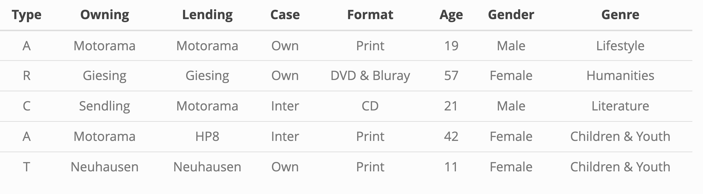

**Transaction Types**

**A** = Borrow   **R** = Return  
**T** = Renewal **C** = Rejected renewal 

  - **RQ 1 & 3**: Borrow transactions
  - **RQ 2**: Borrow & Return transactions

**Data Size**
**Before Cleaning:** 4,689,173 rows  
**After Cleaning:** 1,489,147 rows

# RQ1: Spatial and Structural Analysis 

## Library Usage Across Munich

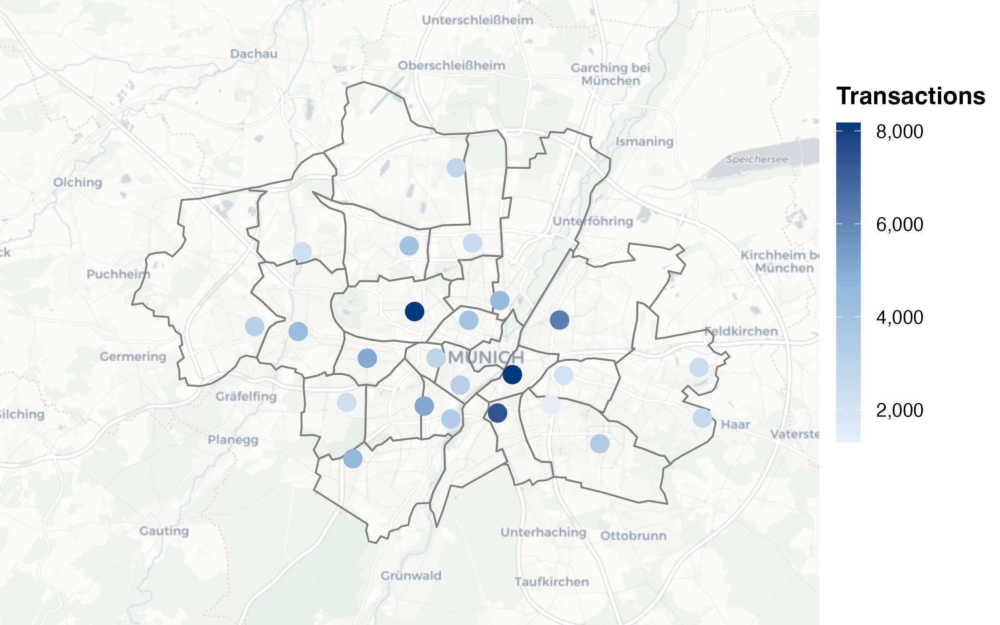
 
 - First part of the analysis is based on **borrowing transactions** only (returns and invalid ID excluded)
 

## Top Lending Libraries by Number of Transactions

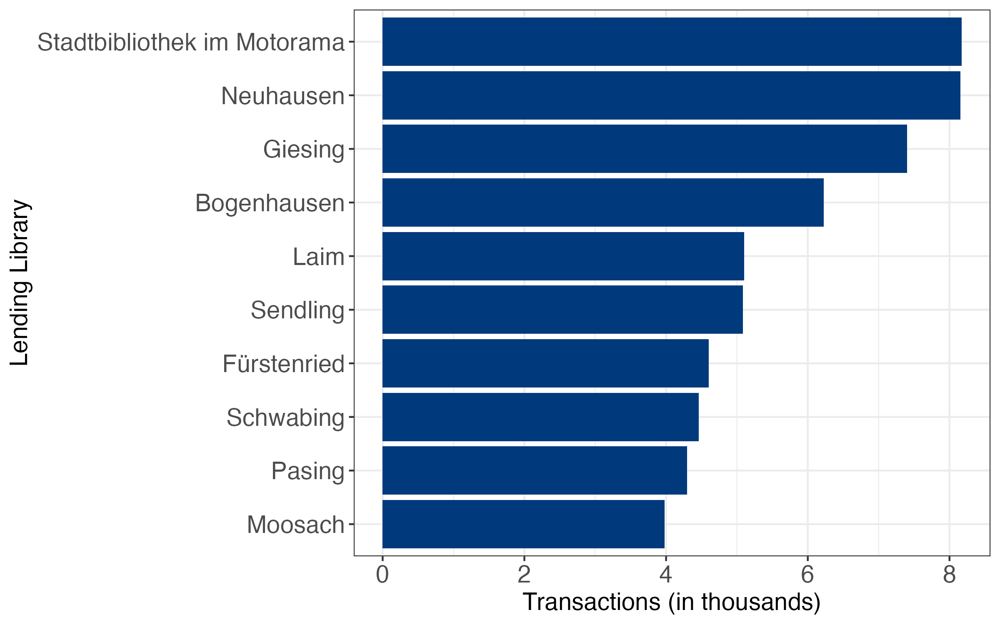

## Own-Branch vs Inter-Branch Borrowing by Library

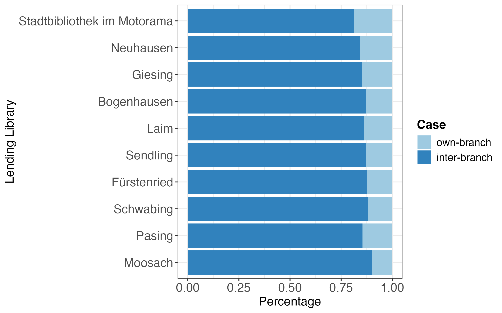

 - On average, about 86% of inter-branch transactions

## What Are the Sources of Inter-branch Transactions?

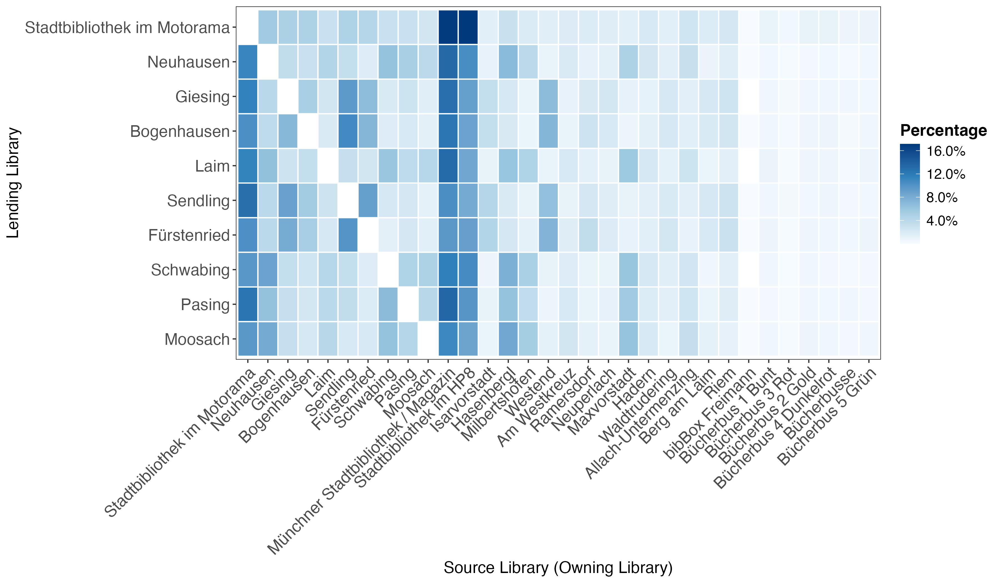

 - On average, ~32% of inter-branch transactions (top 10 libraries) come from three major hubs

# RQ2: Temporal Analysis

## Monthly Library Transactions

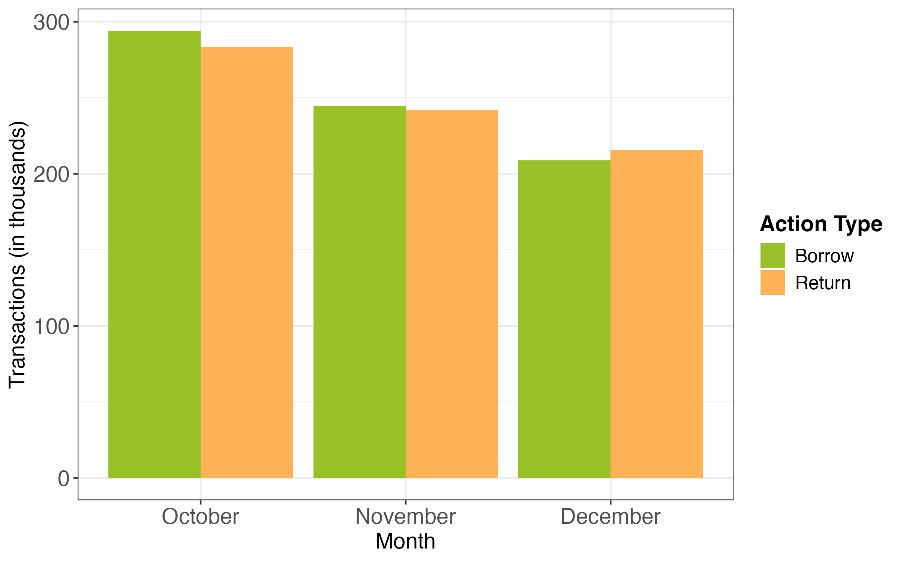

- Second part of the analysis is based on **borrowing transactions** and **returning transactions**.

## Weekly Library Transactions

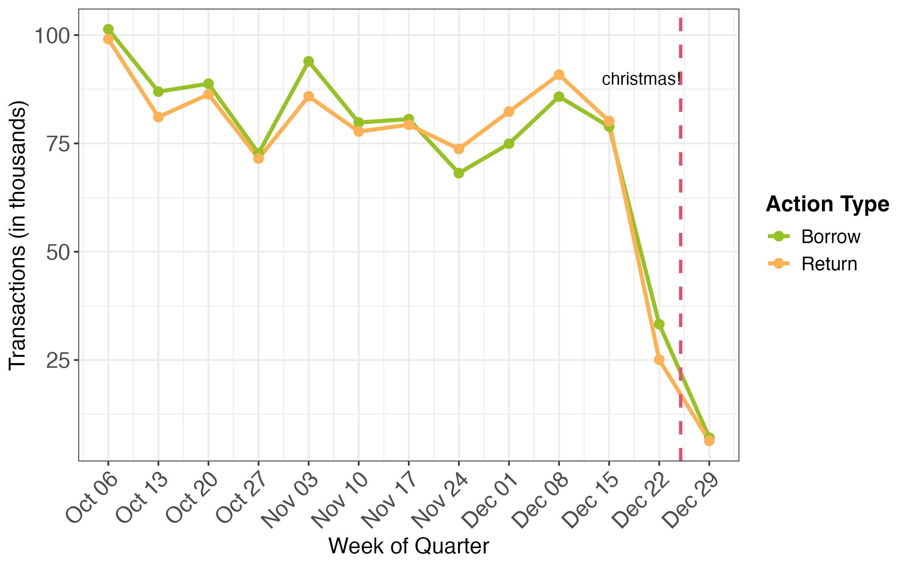

## Transaction Pattern by Day of the Week
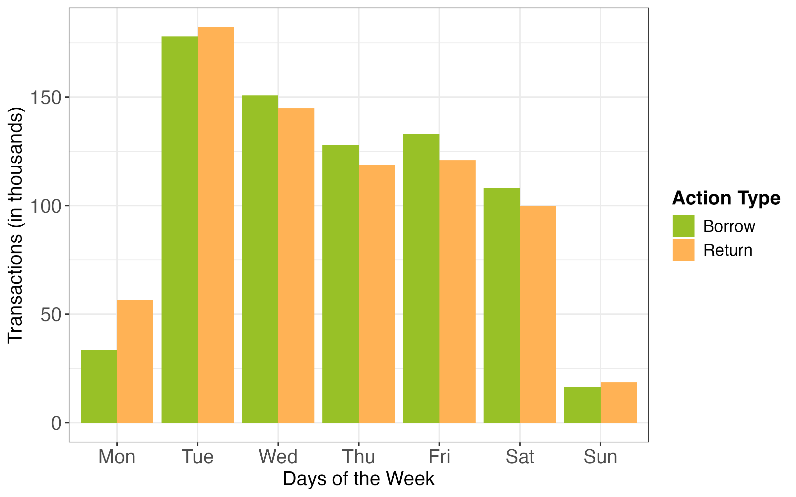

 - Some libraries are close on *Monday* and *Sunday*.

## Hourly Library Transactions by Day of the Week

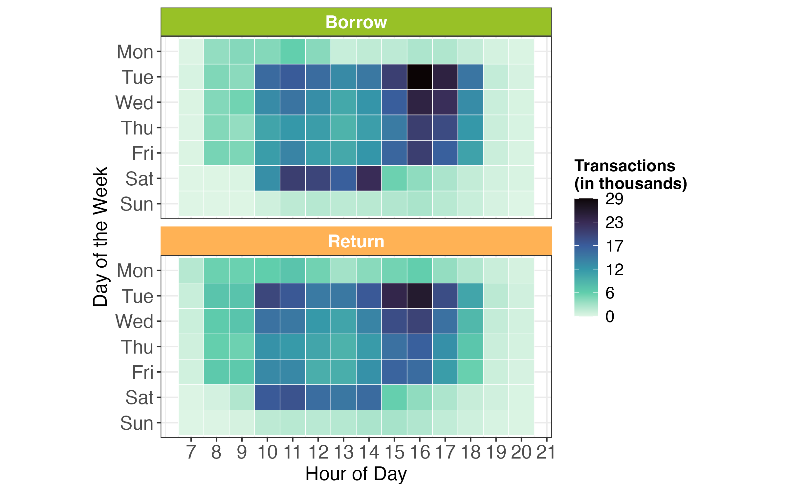

# RQ3: User Preference Analysis

## Library Borrows by Genre 

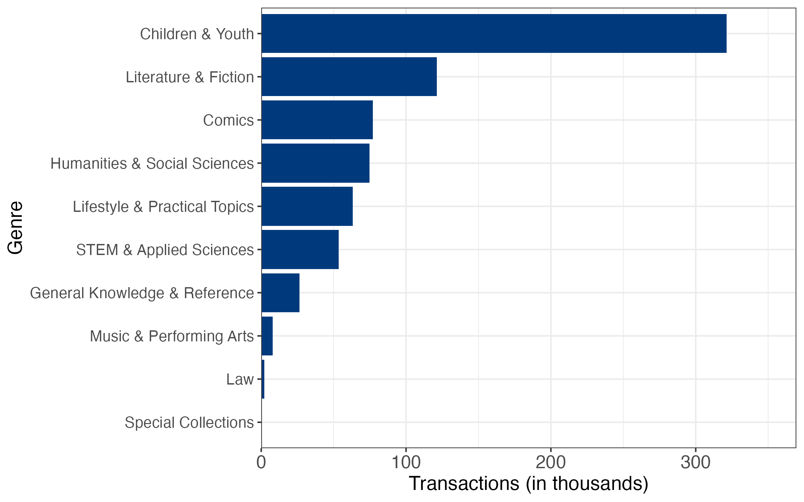
 
 - Third part of the analysis is based on **borrowing transactions** only. (returns excluded)

## Genre Preference by Gender

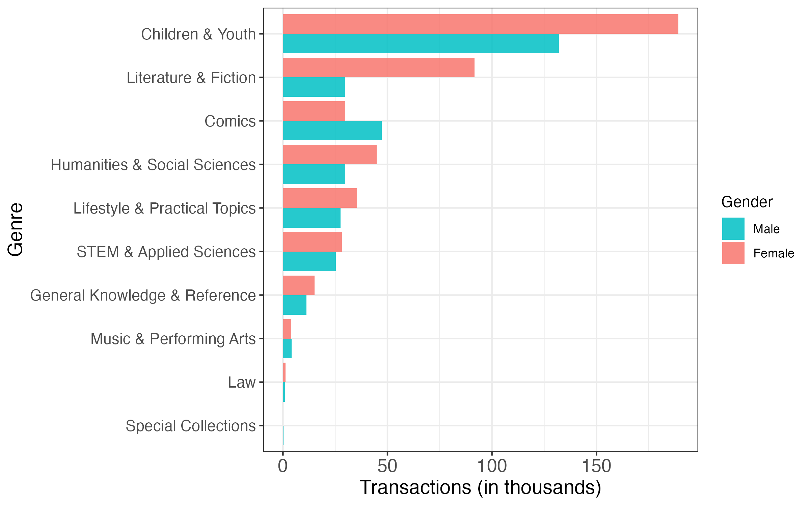

## Book Genre Preferences Across Age Groups

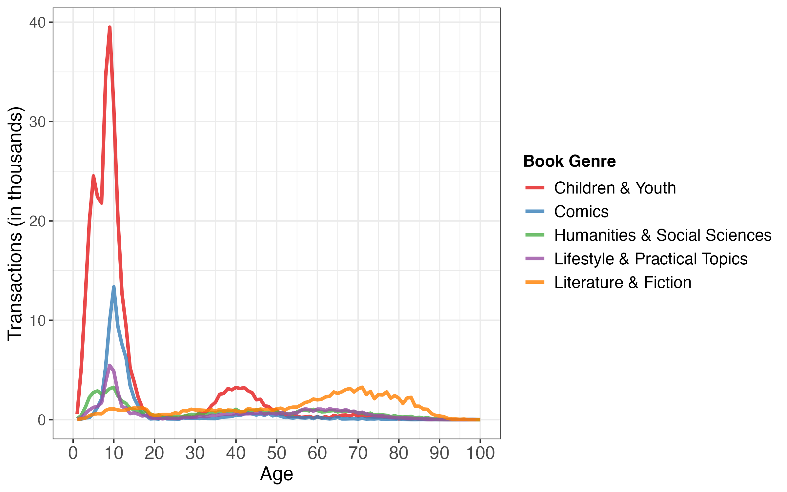

 
## Borrowing Density by Age and Gender

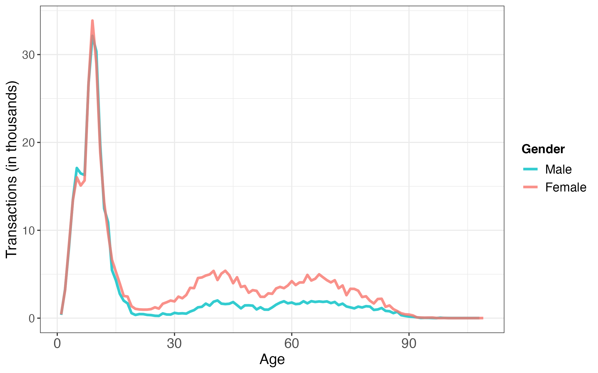

## Key Findings and Conclusion

 - Libraries located *in central areas* are used more frequently.
 - The Münchner Stadtbibliothek, HP8, and Motorama act as *major hubs* for interbranch transactions,
 but borrowing sources remain diverse.
 - A noticeable *decline in activity* occurs during the *Christmas season*(After 15th of Dec).
 - Tuesday showed the highest level of usage, especially between *3pm and 5pm*.
 - *Users aged 7 to 12* represent the most *active group* (Children & Youth).
 - Genre preferences vary across different age groups and genders.
 

## Limitation

 -   The lending library ID contains many invalid values (-1).  
  After removing these entries, only about *14%* of the original data remained (~86% excluded).  
  This mainly affects *the spatial Analysis (Part 1)*, while other analyses are not impacted.

 - The dataset only covers *Q4* 2025 (Oct –Dec).  
  Seasonal patterns across other periods cannot be analyzed.
  
 - Categories such as *diverse* and *institute* (~11%) were excluded.

  

## Discussion

- A small number of central libraries (e.g., Motorama, HP8, Magazin) act as key hubs,  but inter-branch borrowing 
remains widely distributed across the network  

- Library usage follows clear temporal patterns,  
  with strong weekday peaks (especially Tuesday afternoons) and a sharp decline during Christmas  

- User behavior is highly demographic-driven:  
  younger users (7–12) dominate activity, and genre preferences vary by age and gender  

\vspace{0.5em}

→ How can these patterns be used to optimize resource allocation,  
   staffing, and collection distribution across libraries?
   
   
# Appendix

## Why are there some late transaction?

- **Borrowing / Pick-up**
  - Stadtbibliothek Giesing, Stadtbibliothek im Motorama open until 22.
  - Stadtbibliothek im HP8 opens until 23. 
 
- **Returning**
  - Book returns are possible outside opening hours via return boxes;
  however, timestamps may reflect delayed processing rather than the exact
  time of return.

## Why is the plot not jagging in the interval?

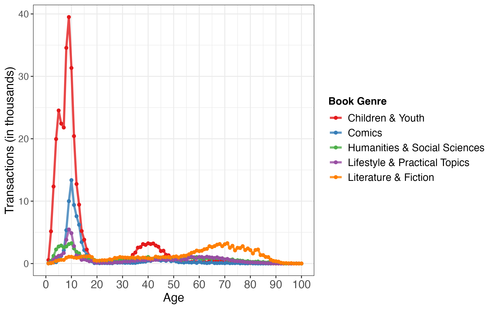

 - Smoother patterns at younger ages result from more continuous transitions between adjacent age groups, not differences in data availability.
 

## Top10 Book Titles among Children & Youth

 - Strong preference for humorous and easy-to-read books with playful, everyday  language

## Top10 Book Titles among Literature & Fiction

 - Titles suggest a focus on adult-oriented themes such as relationships, emotions, and personal development

## Top10 Book Titles among Humanities & Social Sciences

 - Some hybrid materials (e.g., Edurino) are classified as PRINT and thus included. Top titles are primarily educational, focusing on school learning and cognitive skill development.

## Top10 Book Titles among Lifestyle & Practical Topics

 - Borrowing is driven by interest-based topics, particularly sports and gaming.
 
## Top10 Book Titles among Comics

 
 - All top titles belong to the “Walt Disney Lustiges Taschenbuch” series, indicating a strong dominance of a single comic franchise.
 

## Full Heatmap (add row-wise up to 100%)

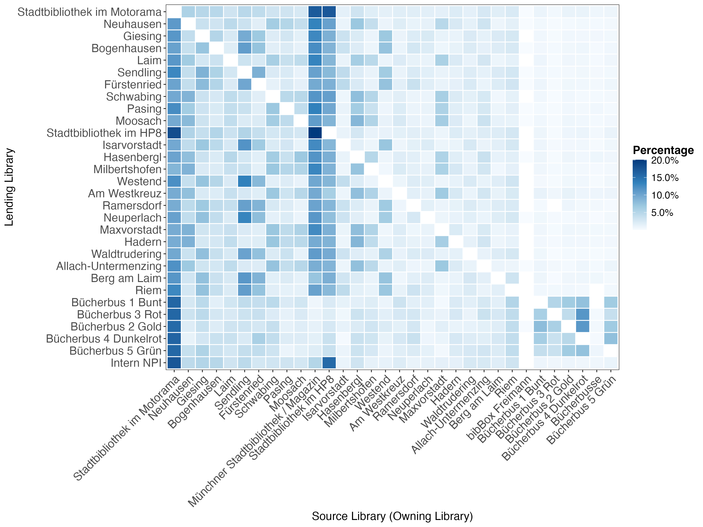

